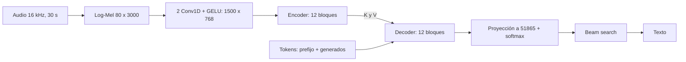
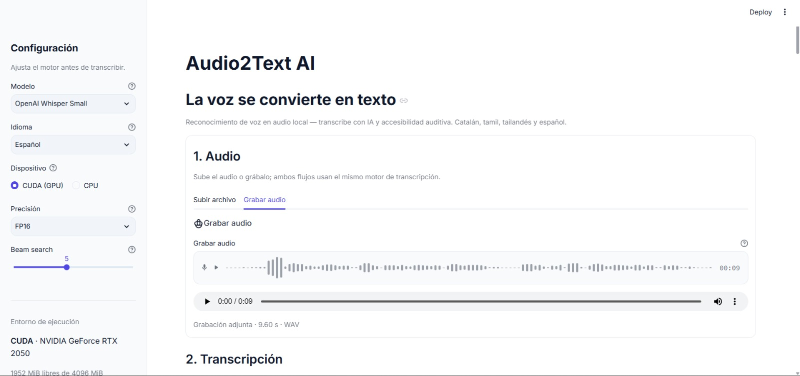

# Audio2Text AI

**Reconocimiento automático de voz con Transformers encoder-decoder (DistilWhisper y Whisper)**

Proyecto final · Procesamiento de Datos Secuenciales

**Integrantes:** `[Nicolas Esteban Pulido Poveda]`, `[Brandon Steven Ramos Enriquez]`, `[Davinson Tulande]`, `[Nombre 4]`

---

## Tabla de contenido

1. [Resumen (Abstract)](#1-resumen-abstract)
2. [Introducción](#2-introducción)
3. [Marco teórico](#3-marco-teórico)
4. [Metodología](#4-metodología)
5. [Desarrollo e implementación](#5-desarrollo-e-implementación)
6. [Resultados y análisis](#6-resultados-y-análisis)
7. [Conclusiones](#7-conclusiones)
8. [Referencias](#8-referencias)

---

## 1. Resumen (Abstract)

Audio2Text AI es una aplicación local de reconocimiento automático del habla (ASR) basada en una arquitectura **Transformer encoder-decoder**. Se utiliza el modelo preentrenado `naver/multilingual-distilwhisper-28k` (DistilWhisper), que extiende a Whisper-small con expertos específicos por idioma entrenados mediante destilación de conocimiento, y como modelo alternativo para español `openai/whisper-small`.

El trabajo **no entrena ni modifica pesos**: implementa el proceso de **inferencia** con el código y los pesos oficiales, añade el manejo de audios de más de 30 segundos mediante fragmentación con timestamps por segmento, y ofrece una **interfaz web interactiva con Streamlit** que permite subir un archivo o grabar desde el micrófono y observar la transcripción, las métricas y los segmentos.

Con un audio de 20,70 s en catalán (FLEURS) en una GPU RTX 2050 de 4 GB, el sistema obtuvo un **CER de 2,86 %** y un **WER de 9,80 %**, con una latencia de **7,72 s** y **1315 MiB** de VRAM en FP16. Las cuatro configuraciones evaluadas producen exactamente los mismos 109 tokens que la verificación de referencia con `transformers 4.30.1`, lo que valida la implementación.

---

## 2. Introducción

### Artículo base y repositorio original

| Elemento | Referencia |
|---|---|
| Artículo | T. Palmeira Ferraz, M. Zanon Boito, C. Brun y V. Nikoulina, *DistilWhisper: Efficient Distillation of Multi-Task Speech Models via Language-Specific Experts*, ICASSP 2024. [arXiv:2311.01070](https://arxiv.org/abs/2311.01070) |
| Repositorio original | [naver/multilingual-distilwhisper](https://github.com/naver/multilingual-distilwhisper) (incluido sin modificar en `vendor/multilingual-distilwhisper/`) |
| Pesos | [naver/multilingual-distilwhisper-28k](https://huggingface.co/naver/multilingual-distilwhisper-28k) |
| Modelo alternativo | [openai/whisper-small](https://huggingface.co/openai/whisper-small) |

### Contexto y motivación

El reconocimiento del habla convierte una secuencia de audio en una secuencia de texto. Whisper (OpenAI) demostró que un solo Transformer entrenado con supervisión débil a gran escala puede transcribir decenas de idiomas, pero los modelos pequeños rinden peor que los grandes en idiomas con pocos datos, y los modelos grandes son costosos de ejecutar. DistilWhisper aborda este problema: mejora a Whisper-small en idiomas de pocos recursos sin el costo de Whisper-large.

### Objetivo

Aplicar una arquitectura Transformer encoder-decoder ya desarrollada a un problema de datos secuenciales (voz a texto), **comprender su funcionamiento a fondo** (entradas, salidas, atención, tensores Q/K/V, innovaciones) y demostrar la **inferencia funcional** con una interfaz interactiva.

---

## 3. Marco teórico

### 3.1 Arquitectura general

Ambos modelos son Transformers **encoder-decoder** (secuencia a secuencia). El encoder convierte el audio en una representación contextual; el decoder genera el texto token por token consultando esa representación mediante atención cruzada.



| Parámetro (Whisper-small) | Valor |
|---|---|
| Capas encoder / decoder | 12 / 12 |
| Dimensión del modelo (d_model) | 768 |
| Cabezas de atención | 12 (64 dimensiones por cabeza) |
| FFN interna | 3072, activación GELU |
| Vocabulario | 51 865 tokens |
| Posiciones máximas del decoder | 448 |
| Parámetros | ≈ 244 M |

### 3.2 Entrada del modelo

1. Remuestreo a 16 kHz y ajuste a **30 s** (480 000 muestras).
2. **Espectrograma log-Mel** de 80 bandas (ventanas de 25 ms, salto de 10 ms): tensor de **80 × 3000**.
3. Dos convoluciones 1D con GELU; la segunda con stride 2: tensor de **1500 × 768** (una posición cada ≈ 20 ms).
4. Suma de embeddings posicionales sinusoidales.

### 3.3 Mecanismo de atención

La atención calcula, para cada posición, un promedio ponderado de la información de todas las demás:

```
Atención(Q, K, V) = softmax( Q · Kᵀ / √d_k ) · V
```

- **Q · Kᵀ** mide la similitud entre cada consulta y cada clave.
- **√d_k** (d_k = 64) evita que los productos punto crezcan y saturen el softmax.
- **softmax** convierte los puntajes en probabilidades (pesos de atención).
- Multiplicar por **V** mezcla la información según esos pesos.

Se usa **atención multi-cabeza**: 12 atenciones en paralelo de 64 dimensiones, cuyas salidas se concatenan (12 × 64 = 768) y se proyectan con una matriz W_O de 768 × 768.

### 3.4 Creación y función de los tensores Q, K y V

Q, K y V se obtienen multiplicando la entrada X por tres matrices de pesos aprendidas (`q_proj`, `k_proj`, `v_proj`):

| Tensor | Cálculo | Función |
|---|---|---|
| **Q** (query) | X · W_Q | Qué información busca cada posición |
| **K** (key) | X · W_K | Qué ofrece cada posición para ser encontrada |
| **V** (value) | X · W_V | La información que se transmite |

Existen tres tipos de atención según el origen de Q, K y V:

| Tipo | Ubicación | Q | K y V | Matriz de atención (por cabeza) |
|---|---|---|---|---|
| Auto-atención | Encoder | audio | audio | 1500 × 1500 |
| Auto-atención enmascarada | Decoder | tokens | tokens | T × T (triangular, causal) |
| Atención cruzada | Decoder | tokens | salida del encoder | T × 1500 |

En la **atención cruzada** el decoder pregunta qué parte del audio es relevante para la palabra que está escribiendo; es el puente entre audio y texto.

### 3.5 Bloques del encoder y del decoder

- **Bloque del encoder:** auto-atención → FFN (con LayerNorm previa y conexiones residuales). Forma constante: 1500 × 768.
- **Bloque del decoder:** auto-atención enmascarada → atención cruzada → FFN.

### 3.6 Generación de la salida

La generación es **autoregresiva**:

1. El decoder arranca con el prefijo `[50258, 50270, 50359, 50363]`: `<|startoftranscript|>`, `<|ca|>`, `<|transcribe|>`, `<|notimestamps|>`.
2. En cada paso produce una distribución de probabilidad sobre 51 865 tokens.
3. **Beam search** (5 por defecto) mantiene varias hipótesis en paralelo y elige la secuencia más probable.
4. Se repite hasta `<|endoftext|>` y los tokens se convierten a texto.

### 3.7 Innovaciones

**Whisper:** supervisión débil con ≈ 680 000 horas de audio; un único modelo multitarea y multilingüe controlado por tokens especiales; robustez frente a ruido y acentos.

**DistilWhisper:** añade, para cada idioma, un **módulo experto** (subred feed-forward) cuya contribución se controla con una **compuerta aprendida** (enrutamiento condicional específico por idioma), y entrena esos expertos mediante **destilación de conocimiento** desde Whisper-large-v2. Es **modular**: agregar un idioma no exige reentrenar el modelo completo. Por eso el checkpoint se compone de `model.safetensors` (base) más `expert.<idioma>.bin`.

> Los detalles exactos de la compuerta y del entrenamiento se encuentran en el artículo [1].

### 3.8 Limitaciones del modelo

- Ventana fija de 30 s.
- Costo cuadrático de la atención con la longitud de la secuencia.
- Decodificación autoregresiva lenta, no apta para streaming.
- Posibles alucinaciones y repeticiones con silencio o ruido.
- Sesgo hacia el inglés en los datos de entrenamiento.
- El checkpoint solo incluye expertos para **catalán, tamil y tailandés** (no español).

---

## 4. Metodología

| Aspecto | Descripción |
|---|---|
| Tipo de trabajo | Inferencia con modelos preentrenados; **sin entrenamiento ni modificación de pesos** |
| Modelo principal | NAVER Multilingual DistilWhisper 28k (catalán, tamil, tailandés) |
| Modelo alternativo | OpenAI Whisper Small (español) |
| Lenguaje y librerías | Python 3.13, PyTorch 2.10, `transformers 4.57.3`, Streamlit 1.67.0, `soundfile`, FFmpeg |
| Hardware de prueba | Windows 11, GPU NVIDIA RTX 2050 (4 GB) |
| Datos de prueba | Clips de FLEURS (`ca_es` y `es_419`) en `data/samples/` |
| Métricas | CER, WER, latencia, VRAM pico y comparación token a token con la referencia |

**Proceso seguido:**

1. Ejecutar el modelo oficial en local con una transcripción mínima en catalán.
2. Verificar que la salida coincide token a token con la referencia de `transformers 4.30.1`.
3. Soportar audios de más de 30 s con fragmentación y timestamps por segmento.
4. Construir la interfaz Streamlit sobre el mismo motor de inferencia.
5. Incorporar la entrada por micrófono y Whisper Small para español.

**Uso de pesos preentrenados:** el código original está escrito para `transformers 4.30.1`, que no tiene wheels para Python 3.13. Se aplican **parches de compatibilidad en tiempo de ejecución** (`src/audio2text/compat.py`) sin modificar `vendor/`.

---

## 5. Desarrollo e implementación

### 5.1 Requisitos

- Windows 11 (probado) o Linux.
- Python 3.13.
- `uv` (recomendado) o `pip`.
- GPU NVIDIA con ≥ 1,4 GB libres para FP16 (≥ 2,6 GB para FP32). También funciona en CPU.
- FFmpeg en el PATH (solo para MP3, M4A, AAC, MP4 y MOV; no se necesita para WAV ni FLAC).

### 5.2 Instalación

```powershell
git clone https://github.com/nico10102003/Audio2Text-AI.git
cd Audio2Text-AI

uv venv .venv --python 3.13

# Con GPU NVIDIA:
uv pip install --python .venv\Scripts\python.exe torch==2.10.0 --index-url https://download.pytorch.org/whl/cu128
# Solo CPU: usar --index-url https://download.pytorch.org/whl/cpu

uv pip install --python .venv\Scripts\python.exe -r requirements.txt
```

En Linux o macOS, reemplazar `.venv\Scripts\python.exe` por `.venv/bin/python`.

### 5.3 Descarga de los pesos

Los pesos no están en el repositorio. Se descargan con:

```powershell
.\.venv\Scripts\python.exe -c "from huggingface_hub import hf_hub_download as d; [d('naver/multilingual-distilwhisper-28k', f, local_dir='models/multilingual-distilwhisper-28k') for f in ['config.json','generation_config.json','model.safetensors','expert.catalan.bin']]"
```

Estructura resultante:

```
models/multilingual-distilwhisper-28k/
├── config.json
├── generation_config.json
├── model.safetensors      # 966 997 096 bytes
└── expert.catalan.bin     # 458 178 391 bytes
```

Verificación de integridad (SHA-256):

```
BD07406AB1DD8061E7187A50C11E04CE1650C1EA4A2C4D6CF1EBD6B31C20C5E1  model.safetensors
DC7192D0B60A9960169CBC5C2F283B028B857D20307E822B4E30E293E4E88FE8  expert.catalan.bin
```

Whisper Small se descarga automáticamente desde Hugging Face la primera vez que se usa.

### 5.4 Ejecución

```powershell
.\.venv\Scripts\streamlit.exe run streamlit_app.py
```

La aplicación abre en `http://localhost:8501`. En Windows también basta con hacer doble clic en `run.bat`. Con GNU Make: `make run`.

### 5.5 Cómo se cargan los pesos

1. `engine.py` lee `config.json` y `generation_config.json` de `models/multilingual-distilwhisper-28k/`.
2. Se instancia la clase del modelo del repositorio oficial (`vendor/multilingual-distilwhisper/`) y se cargan los pesos base desde `model.safetensors`.
3. Se carga el experto del idioma elegido (`expert.<idioma>.bin`).
4. El modelo se mueve a CUDA o CPU, en FP16 o FP32.
5. En Streamlit, el modelo queda en caché (`st.cache_resource`) con clave `(ruta, idioma, dispositivo, precisión)`, y se libera la VRAM al cambiar de configuración.

Para Whisper Small se usan `WhisperForConditionalGeneration` y `WhisperProcessor`.

### 5.6 Preprocesamiento

1. Lectura del audio: WAV y FLAC con `soundfile`; MP3, M4A, AAC, MP4 y MOV con FFmpeg.
2. Conversión a mono y remuestreo a 16 kHz.
3. Si dura más de 30 s, fragmentación (ver 5.8).
4. Cálculo del espectrograma log-Mel de 80 bandas.

### 5.7 Inferencia

1. Se construye el prefijo explícito `[50258, 50270, 50359, 50363]` y se pasa como `decoder_input_ids`. Sin él, `transformers ≥ 4.50` omite `<|transcribe|>` y `<|notimestamps|>` y produce texto incorrecto.
2. Generación autoregresiva con beam search (5 por defecto) o greedy.
3. Decodificación de los tokens a texto.
4. La salida es idéntica token a token a la de `transformers 4.30.1`.

### 5.8 Audio largo (chunking)

1. Se busca la última pausa (RMS bajo durante ≥ 0,4 s) anterior a los 30 s y se corta ahí.
2. Si no hay pausas, se usan ventanas de 30 s con 2 s de solapamiento y se elimina el texto repetido comparando palabras normalizadas.
3. Cada fragmento conserva el prefijo y los parámetros de generación.
4. Los timestamps son estimaciones por segmento.

### 5.9 Interfaz Streamlit

- **Entrada de audio:** subir archivo (WAV, FLAC, MP3, M4A, AAC, MP4, MOV; hasta 200 MB) o grabar con el micrófono.
- **Configuración:** modelo, idioma, dispositivo (CUDA/CPU), precisión (FP16/FP32) y beam search.
- **Resultados:** texto completo, latencia, segmentos con inicio y fin, descargas TXT/JSON.
- **Historial** de la sesión (máximo 20 resultados) y botón para liberar el modelo de memoria.

### 5.10 Línea de comandos

```powershell
.\.venv\Scripts\python.exe scripts\run_inference.py `
  --audio data\samples\ca_es_long.wav `
  --reference data\samples\reference_ca_long.txt `
  --json-out logs\inference_long_fp16.json
```

### 5.11 Estructura del repositorio

```
streamlit_app.py            # interfaz: subida/grabación, configuración, resultados
run.bat                     # inicio con doble clic en Windows
Makefile                    # atajos: run, test, test-real, check, clean
requirements.txt
.streamlit/config.toml      # tema y límite de subida
src/audio2text/
├── engine.py               # carga del modelo, audio, transcribe / transcribe_auto
├── chunking.py             # ventanas, cortes por silencio, unión sin duplicados
├── compat.py               # parches de compatibilidad con transformers 4.57
├── legacy_attention.py     # WhisperAttention con el contrato de transformers 4.30
├── metrics.py              # CER y WER
└── ui_service.py           # validación de subidas, TXT/JSON, historial
scripts/                    # prepare_sample, make_long_sample, run_inference, clean_caches
tests/                      # 90 pruebas (86 rápidas y 4 de inferencia real)
vendor/multilingual-distilwhisper/   # repositorio oficial de NAVER, sin modificar
data/samples/               # audios de prueba (catalán y español)
docs/INFORME.md             # informe técnico detallado
```

### 5.12 Pruebas

```powershell
.\.venv\Scripts\python.exe -m unittest discover -s tests -v
```

Resultado esperado: `Ran 90 tests ... OK (skipped=4)`. Las 4 pruebas omitidas son de inferencia real y se activan con `AUDIO2TEXT_RUN_UI_INFERENCE=1` o `AUDIO2TEXT_RUN_WHISPER_INFERENCE=1`.

---

## 6. Resultados y análisis

### 6.1 Capturas de las pruebas realizadas

## Capturas de la aplicación

A continuación, se presentan evidencias visuales de la interfaz de Audio2Text AI y de sus funcionalidades principales.

### 1. Pantalla inicial y configuración

La aplicación cuenta con una interfaz desarrollada en Streamlit que permite seleccionar el modelo de inteligencia artificial, el idioma, el dispositivo de ejecución y la precisión numérica. También permite cargar archivos de audio o realizar grabaciones directamente desde el micrófono.



### 2. Resultado de la transcripción

La aplicación presenta el texto generado por el modelo, junto con información sobre la duración del audio, la latencia de inferencia y los segmentos procesados. También permite copiar y descargar los resultados en formatos TXT y JSON.

### 3. Información del entorno de ejecución

La interfaz muestra información sobre el dispositivo utilizado (CPU o CUDA), la GPU detectada, la precisión numérica seleccionada y el consumo de memoria de la tarjeta gráfica.

### 4. Historial de transcripciones

La aplicación permite consultar las transcripciones realizadas durante la sesión, seleccionar resultados anteriores y acceder nuevamente a su contenido.

Las capturas adicionales de estas funcionalidades se incorporarán conforme se realicen las pruebas correspondientes desde la aplicación.

### 6.2 Métricas: audio corto en catalán

Audio `data/samples/ca_es_sample.wav` (FLEURS `ca_es`, 20,70 s, 16 kHz mono), GPU RTX 2050.

| Dispositivo | Precisión | Búsqueda | Latencia | VRAM pico | CER | WER |
|---|---|---|---|---|---|---|
| CUDA | FP32 | beam 5 | 9,66 s | 2592 MiB | 2,86 % | 9,80 % |
| CUDA | FP16 | beam 5 | 7,72 s | 1315 MiB | 2,86 % | 9,80 % |
| CPU | FP32 | beam 5 | 28,78 s | no aplica | 2,86 % | 9,80 % |
| CUDA | FP32 | greedy | 6,92 s | 1603 MiB | 2,86 % | 9,80 % |

Transcripción obtenida:

> Avui en dia, la cuina japanesa és fàcil de trobar per tot arreu de l'arxipèleg i ofereix una gran varietat de plats condimentats de forma senzilla. Els sabors preferits als japanesos solen ser els dels cacauets, els bitxos, el sucre, sobretot el sucre, coco javanès i diverses espècies aromàtiques.

### 6.3 Audio largo (chunking)

Audio sintético de 42,40 s (el clip FLEURS repetido dos veces con 1 s de silencio): CUDA, FP16, beam 5.

| Segmentos | Latencia | VRAM pico | CER | WER |
|---|---|---|---|---|
| 2 (0,00–21,01 s y 21,01–42,40 s) | 16,26 s | 1315 MiB | 4,49 % | 12,75 % |

### 6.4 Whisper Small en español

| Audio | Latencia | VRAM pico |
|---|---|---|
| `es_es_sample.wav` (8,40 s) | 2,54 s | 786 MiB |
| `es_es_long.wav` (36,60 s, 2 segmentos) | 15,84 s | no medido |

### 6.5 Inferencia a través de la interfaz

| Flujo | Audio | Latencia (modelo en caché) | Segmentos |
|---|---|---|---|
| Corto | `ca_es_sample.wav` (20,70 s) | 6,35 – 8,18 s | 1 |
| Largo | `ca_es_long.wav` (42,40 s) | 15,33 – 18,57 s | 2 |

### 6.6 Análisis

- **Validez de la implementación:** las cuatro configuraciones producen los mismos 109 tokens que la referencia con `transformers 4.30.1`. El uso de FP16 o CPU no altera el resultado.
- **Rendimiento:** FP16 reduce la VRAM de 2592 a 1315 MiB (≈ 49 %) y la latencia de 9,66 a 7,72 s, sin pérdida de precisión. La CPU es unas 3,7 veces más lenta que CUDA con FP16.
- **Errores:** las diferencias con la referencia de FLEURS son principalmente ortográficas (`japanesa`/`javanesa`, `arxipèleg`/`arxipèlag`) y de puntuación, no de contenido.
- **Audio largo:** el corte en la pausa evita texto perdido o duplicado en la unión. La segunda repetición omite `arreu de l'` por variación del modelo, no por el chunking. El CER y el WER suben respecto al clip corto (4,49 % y 12,75 %), porque cualquier omisión pesa más en un texto más largo.
- **Latencia:** crece de forma aproximadamente lineal con el número de ventanas de 30 s.
- **Memoria:** con 4 GB de VRAM, FP16 permite ejecutar cómodamente ambos modelos (se mantiene uno en caché a la vez).

---

## 7. Conclusiones

### Aprendizajes

- En un Transformer encoder-decoder, el encoder entiende el audio y el decoder genera el texto; la **atención cruzada** conecta ambos.
- Q, K y V son proyecciones lineales de la entrada; la atención es un promedio ponderado de los valores según la similitud entre consultas y claves.
- La innovación de DistilWhisper está en combinar **destilación** con **expertos modulares por idioma**, lo que acerca un modelo pequeño al rendimiento de uno grande en idiomas de pocos recursos.
- Un detalle aparentemente menor, el **prefijo de tokens de control**, cambia por completo la calidad de la salida.
- Reutilizar código de investigación exige adaptarlo: las versiones de las librerías cambian y pueden romper la compatibilidad.

### Limitaciones

- El modelo NAVER solo cubre catalán, tamil y tailandés; el español se resuelve con Whisper Small.
- Ventana de 30 s: el audio largo depende de una heurística de fragmentación y deduplicación.
- Los timestamps son por segmento, no por palabra.
- La interfaz no tiene autenticación ni multiusuario (uso local).
- La decodificación autoregresiva no permite transcripción en tiempo real.
- El progreso mostrado es por fases, no por fragmento.

### Posibles mejoras

- Añadir los expertos de tamil y tailandés a los ejemplos y más muestras de prueba.
- Timestamps por palabra (alineamiento).
- Transcripción en streaming.
- Detección de silencio adaptativa al ruido de fondo.
- Evaluación con más audios y más idiomas para obtener métricas más robustas.

---

## 8. Referencias

[1] T. Palmeira Ferraz, M. Zanon Boito, C. Brun y V. Nikoulina, "DistilWhisper: Efficient distillation of multi-task speech models via language-specific experts," en *Proc. IEEE Int. Conf. Acoustics, Speech and Signal Processing (ICASSP)*, 2024. arXiv:2311.01070.

[2] A. Radford, J. W. Kim, T. Xu, G. Brockman, C. McLeavey e I. Sutskever, "Robust speech recognition via large-scale weak supervision," en *Proc. Int. Conf. Machine Learning (ICML)*, 2023. arXiv:2212.04356.

[3] A. Vaswani et al., "Attention is all you need," en *Advances in Neural Information Processing Systems (NeurIPS)*, 2017.

[4] B. Zhang, A. Bapna, R. Sennrich y O. Firat, "Share or not? Learning to schedule language-specific capacity for multilingual translation," en *Proc. Int. Conf. Learning Representations (ICLR)*, 2021.

[5] A. Conneau et al., "FLEURS: Few-shot learning evaluation of universal representations of speech," en *Proc. IEEE Spoken Language Technology Workshop (SLT)*, 2022.

[6] NAVER Labs Europe, "naver/multilingual-distilwhisper-28k," Hugging Face. [En línea]. Disponible: https://huggingface.co/naver/multilingual-distilwhisper-28k

[7] NAVER Labs Europe, "multilingual-distilwhisper," GitHub. [En línea]. Disponible: https://github.com/naver/multilingual-distilwhisper

[8] OpenAI, "openai/whisper-small," Hugging Face. [En línea]. Disponible: https://huggingface.co/openai/whisper-small
